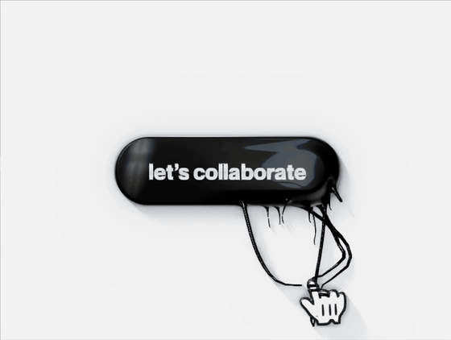

# Venom Button

A symbiote button for the web. A matte, jet-black slab of goo sits on a white studio floor. Bring the cursor close and the surface reaches for it: thin, stretchy tendrils lunge out, web together like pulled mozzarella, coil around the cursor and hold on. Pull away and they neck, snap, and recoil back into the body like melted rubber.

**[Live demo →](https://exteestudio.github.io/venom-button/)** · [2× for big screens](https://exteestudio.github.io/venom-button/?scale=2)



[Watch the full-quality clip (MP4)](media/demo.mp4)

One HTML file, raw WebGL2, no dependencies, no build step.

## Run it

Open `index.html` in a recent Chrome, Edge, Safari or Firefox. That's it.

Or serve the folder with anything static:

```bash
npx serve .
```

### Big screens and demos

Add `?scale=2` (or `3`, up to `4`) to the URL to render the whole scene larger. Everything scales together: the button, text, tendrils, cursor, shadows and reflections.

```
index.html?scale=2
```

## What it does

- **Reaches for you.** As the cursor approaches, a fizz of tiny strings rises along the facing edge, then thin tendrils lunge out, curve, and latch on.
- **Wraps the cursor.** The cursor becomes a 3D hand icon. Each tendril winds a coil around its own finger or the wrist, passing over and tucking underneath the icon.
- **Feels caught.** The web tugs the hand a few pixels toward the goo and turns it with the pull. Pulling away meets a little friction; when the strands snap, it pops back onto your pointer.
- **Stretches and snaps.** Tendrils thin as they stretch, shed mozzarella fibres, string cheesy webs between each other, then pinch off at the neck and recoil.
- **Stays alive.** Every couple of seconds a small burst of strands curls out somewhere new on the edge and sinks back like a wave.
- **Lifts on hover.** With the cursor on the button, the whole slab rises off the floor and its shadow softens and spreads.
- **Looks real.** Matte rubber face, a silver label layer, a rim light with a travelling glint, an out-of-focus window reflection with slight RGB dispersion, and a layered contact shadow.

## Make it yours

### Label

Change the text in one place:

```js
const LABEL_TEXT = 'let’s collaborate';
```

Or drop / paste any SVG onto the page (for example "Copy as SVG" from Figma) and it becomes the silver label. The button resizes to hug it. From code:

```js
VenomButton.setLabel(svgString);
```

### Tuning

Press **T** (or click **Tune** in the corner) for live sliders: reach, number of tendrils, snap stretch, max length, viscous flow, slither, lunge speed, magnetism, web grip, thickness, surface pull, gravity and sheen. **Copy values** puts the current settings on your clipboard as JSON.

### Clicks

The button is a real `<button>` element, keyboard focusable and labelled for screen readers. Listen for activation:

```js
VenomButton.element.addEventListener('venom:activate', () => { /* … */ });
```

## How it works

- **Scene:** a top-down ray march of a 3D signed distance field (the slab, every tendril segment, finger coils, fibres and the cursor icon), blended with polynomial smooth-min so strands fillet into the surface. Pass 1 writes a height/normal G-buffer.
- **Shading:** pass 2 lights it like a black product shot: shaped studio lights, a procedural room reflection, matte and glossy materials, heightfield soft shadows, ambient occlusion and an analytic contact shadow. Pass 3 applies FXAA.
- **Physics:** tendrils are substepped Verlet chains (240 Hz) with length and bend constraints, volume-conserving radii, viscoelastic creep, Rayleigh–Plateau beading and pinch-off. Recoil retracts along the strand's own path, so it never buckles.
- **Cursor:** the arrow and hand icons are baked into signed distance fields from their SVGs, so the arrow can shape-morph into the hand and the goo can wrap a real 3D slab.

Respects `prefers-reduced-motion` (no tendrils, static surface) and falls back to a plain CSS button without WebGL2.

## Credits

- **Font:** [Geist](https://vercel.com/font) by Vercel and basement.studio, SIL Open Font License 1.1 (see `fonts/Geist-OFL.txt`).
- **Cursor artwork:** the `left_ptr` and `hand2` icons from the Figma Community file "Cursors" (source SVGs in `cursors/`).
- **Techniques:** smooth-min and SDF primitives after [Inigo Quilez](https://iquilezles.org/articles/); heightfield goo inspired by Robert Leitl's [Ferrofluid](https://github.com/robert-leitl/ferrofluid).

## License

[MIT](LICENSE) © 2026 exteestudio
