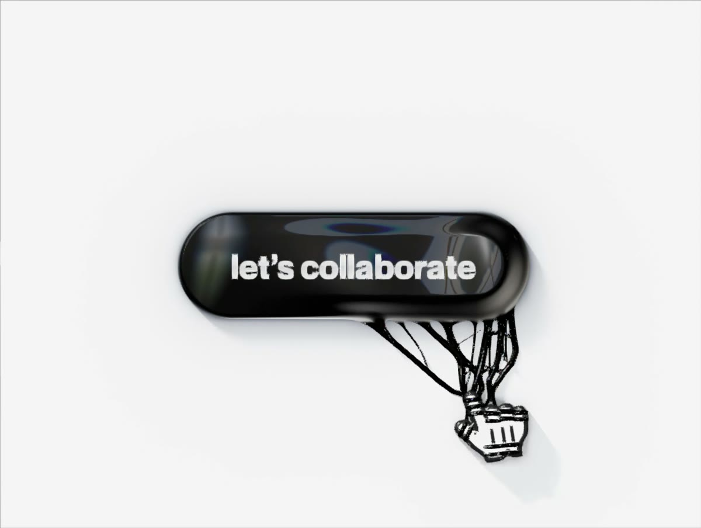

**02 · THE PROCESS**

# 25 rounds of plain English

*Every change to the button came from a sentence like the ones below. Quotes are my actual messages (lightly trimmed for typos). Under each one: what Claude changed in response.*

**Phases:** [1 · First sculpt](#phase-1--first-sculpt) · [2 · The cursor](#phase-2--the-cursor) · [3 · From blob to rubber](#phase-3--from-blob-to-rubber) · [4 · The cursor, refined](#phase-4--the-cursor-refined) · [5 · Type and light](#phase-5--type-and-light) · [6 · Feel](#phase-6--feel) · [7 · Ship](#phase-7--ship)

---

## Phase 1 · First sculpt

### 01 · The brief
> "A venom button… liquidy black but stretchy, like a spider web moving towards it… There should be strands."

- Researched goo, ferrofluid and rope-physics techniques; chose raw WebGL2 in one HTML file.
- First version: glossy black pill, tendrils that lunge, latch, stretch, snap and recoil, surface ripples, a droplet at the cursor.
- See [01 · The brief](01-the-brief.md) for the full message.

---

## Phase 2 · The cursor

### 02 · Bring in my Figma cursors
> "My cursor should be this cursor… [arrow] as the default… [hand] when the hover state occurs, not hanging."

- Pulled both icons straight from the Figma file and set them as native cursors, so they never lag behind the mouse.
- Hand appears only over the actual pill shape, not the button's square corners.

### 03 · A small confirmation
> "Keep the goo droplet grabbing the cursor tip as it is."

- No change. Short answers like this keep momentum.

### 04 · Let the goo wrap the hand
> "No droplet by default hanging. Increase the size of these SVGs when they hover… significantly bigger. The Venom… would wrap around the hand… very thin material wrapped around it."

- The hand became a real 3D object in the scene, built from the Figma SVG, so strands could pass **over and under** it.
- Each tendril now claims a finger or the wrist and winds a glossy coil around it. Snapping unwinds the coils.

---

## Phase 3 · From blob to rubber

### 05 · A reference image changes everything
> *Shared a Venom material study (approach, stretch, merge, self-heal)*
> "Reduce the distance the stretch happens… when the hand goes through the button it should be fully covered… make the strands more minute… remove those horizontal lines… the edges are getting pixelated… more strandy and cheesy, like mozzarella."

- Shorter reach and snap distances; smaller hand.
- Goo creeps over the hand as it nears the button.
- Thinner tendrils plus **mozzarella fibres** that peel off stretched strands.
- Removed the long streak highlight; added an anti-aliasing pass (FXAA) for clean edges.

### 06 · Rubber, not water
> "Tinier strands at the surface when they come in… it's not spidery… it's more fluidy, but that's not what we want… it should move like melted rubber or mozzarella cheese."

- A fizz of **tiny pointed strings** now rises along the surface facing the cursor.
- Every spring damped to near critical: no jiggle, no water-like ripples. Snapped strands return like a rubber band.
- Removed an orange-red rim caused by a colour-shifting sheen.

### 07 · Jet black, finer, smaller
> "Make it perfectly black, dark black, with super clean, even more minutely detailed strands. Make the button a little smaller and the cursor icon smaller too."

- Darker base, dimmer reflections; strands ~30% thinner with a third fibre; button and cursor ~20% smaller.

### 08 · A detour: the preview server
> *An error message pasted in.*

- macOS blocks background processes from reading the Desktop folder. Fixed by serving a mirror copy from an unprotected folder.

### 09 · Spread, don't swell
> "Not every single macro area of that liquid should distort… they should spread from that button to the cursor… there are a lot of increments in the primary size of the button."

- All surface effects now lift only the top face. The outline is locked: measured within 0.5 px of rest while tendrils are out.
- True jet black (13/255), lit by a crisp key highlight and thin rim lights.

---

## Phase 4 · The cursor, refined

### 10 · Morph, closer release, more magnetism
> "There should not be a dot always hovering… make the arrow the same scale as the finger icon… morph very quick… the release point is too far… increase the magnetism."

- Arrow and hand are both 3D icons; the arrow's shape **morphs into the hand in ~0.15 s** as a tendril arrives.
- Release point ~25% closer; tendrils bow toward the cursor (new **Magnetism** control).

### 11 · Stay big
> "Why is the cursor not staying at the bigger size? It gets switched to my default cursor."

- The big rendered cursor is now permanent across the page, never falling back to the system arrow.

---

## Phase 5 · Type and light

### 12 · Lift, sleek edge, real words
> "When the cursor is fully hovered… the entire shape elevates upwards, leaving a soft shadow… the thickness between the shine and the border is too much… hug the word… write 'Come Close' in Neue Montreal… add a realistic living room reflection, slightly saturated… top left."

- Hovering lifts the whole slab 14 px; its shadow drops and softens.
- Bevel tightened from ~12 px to 3 px; the button is sized from the measured width of the word.
- A procedural living room (window, trees, lamp) reflects in the top-left curves.

### 13 · A separate silver layer
> "Make 'Come Close' silver, thicker, without distortion… fully on top of the blob as a separate metallic layer. The button looks too liquidy… more like a rubbery flat surface… jet matte black."

- Label is now its own **polished-silver layer** with a chrome gradient and lit edges; it can't warp.
- Face is flat, **matte rubber**; tendrils stay glossy so the two materials read differently.

### 14 · Window always there, plus dispersion
> "Have the window reflection be there by default, but more like a flatter vibe… add RGB dispersion within the button."

- A flat, planar window reflection on the face; slight red/blue split at its edges and in glossy highlights.

### 15 – 17 · The words
> "Change the text to 'merge'…" → "Make the text 'let's collaborate' and nudge it down a little" → "Nudge it up a little bit, you went too down."

- Copy changes are one line each; the pill re-hugs the text automatically. The final label sits 1 px below centre.

---

## Phase 6 · Feel

### 18 · Caught in a web
> "Add a subtle gradual pull effect on the cursor as the strands wrap around it… exit with subtle friction… the finger cursor should slightly rotate at the angle of the pull."

- The web tugs the drawn hand up to 10 px and turns it up to ~20° toward the pull. On snap it pops back. New **Web grip** control.

### 19 · Rim light and shadow
> "Add a rim light… have it shine and cast a more realistic shadow below it."

- Cool and warm rim lights plus a slow glint that travels round the edge.

### 20 · Not a stock photo
> "The window looks like a stock photo… make it more blurry, scale it and fade it from the edge."

- Out-of-focus, larger, fading into the black.

### 21 · A real surface
> "The button shadow does not look realistic… it's not fading enough, and not darker around the button… the cursor icons… above the button, but not too elevated."

- Shadow rebuilt as contact crease + near occlusion + directional soft shadow + ambient fade, all smooth exponential falloffs.
- Cursor floats 11 px above the button top instead of 40 px above the floor.

### 22 · Idle life
> "The random single blob looks weird… have a couple of strands come out, rotate around it… settle back down really quickly, like a wave… every 2 seconds."

- Bursts of 2–3 thin strands glide along the edge and sink back in ~1 s, every ~2 s.

### 23 · Everywhere
> "Have that happen in different random portions of that button, not just one single place."

- Spots chosen evenly along the whole outline, each at least a quarter turn from the last.

---

## Phase 7 · Ship

### 24 · Big screen
> "Create a duplicate… scale everything up 2x or 3x."

- `?scale=2` / `?scale=3`: the whole scene scales together, pointer mapping included.

### 25 · Open source
> "Can you help me open source this?"

- MIT licence, Geist replacing trial fonts, README, demo media, GitHub Pages live demo.

---

**Next:** [03 · Anatomy of the button →](03-anatomy.md)
