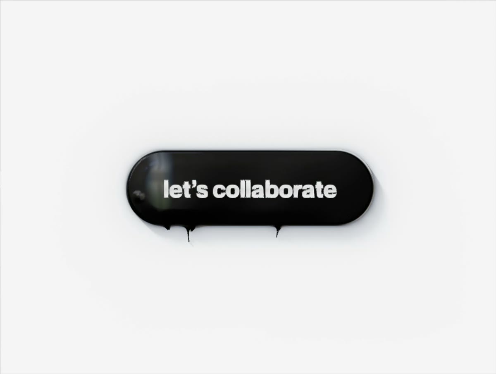
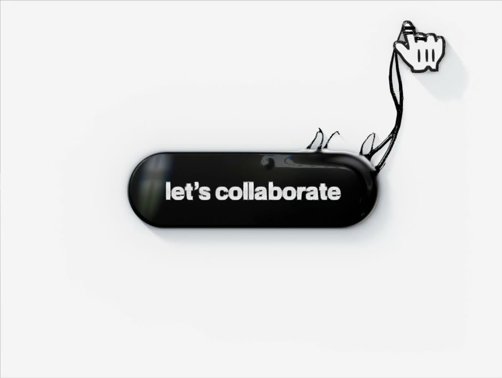

**03 · ANATOMY OF THE BUTTON**

# Every detail, measured

*The finished button, taken apart. All sizes are CSS pixels at 1× (multiply by the `?scale=` value for big screens). Every number here lives in [`index.html`](../index.html), and most can be changed live with the tuning panel (press **T**).*

---

## 1 · The slab

A flat slab of matte black rubber resting on a white floor.

| Property | Value | Notes |
|:--|:--|:--|
| Shape | Pill (rounded rectangle, fully rounded ends) | Ends are perfect semicircles |
| Height | **60 px** | Half-height 30 px |
| Width | **Hugs the label** | Label ink width + **30 px** each side (212 px for "let's collaborate") |
| Thickness | **14 px** above the floor, sinks 5 px into it | Sinking gives a believable contact line |
| Bevel | **3 px** radius | Tight, so the sheen starts right at the border |
| Crown | **1.2 px** | Almost flat; just enough to catch light |
| Surface motion | None at rest | Earlier "breathing" swell was removed so the face reads as solid rubber |
| Hover lift | Rises **14 px**, spring ω 11 / ζ 0.95 | No bounce; shadow detaches and softens |
| Press | Squashes 30% in height, spreads 2.5 px | Spring ω 30 / ζ 0.75 |
| Intro | Grows from a puddle on load | Critically damped, no overshoot |

## 2 · Material

| Layer | Look | Detail |
|:--|:--|:--|
| Base colour | **Jet black, ~13/255** after tone mapping | Diffuse albedo 0.0007, near-zero by design |
| Face | **Matte rubber** | Broad soft sheen (GGX roughness ≈ 0.63) instead of mirror reflections |
| Tendrils | **Glossy goo** | Sharp reflections, so the two materials read differently |
| Dispersion | Red/blue split in reflections | Tiny offsets per colour channel; fringes on window edges and highlights |

## 3 · The lighting rig

Lit like a black product shot in a white studio, with a living room up and to the left.

| Light | Direction | What it does |
|:--|:--|:--|
| **Key** | Top-left, 46° up | Casts the shadow; source of the room reflection |
| **Room** | Top-left, 33° from overhead | Window with frames, sky, tree line, warm wall, a lamp. Slightly saturated |
| **Face window** | Planar reflection, left padding | Out of focus, ~30 px wide, oval fade, sits clear of the first letter |
| **Rim lights** | Cool from top-left, warm from bottom-right | Thin lit edge along the bevel |
| **Glint** | Travels round the contour | One loop every ~7 s |
| **Strip lights** | Low, left and right | Trace the curve of caps and strands |
| **Kicker** | Small, bottom-right | Second highlight so curves read as round |
| **Everything else** | Black | Keeps the body jet black |

## 4 · The shadow

Four layers, each fading smoothly with distance (exponential falloff, never a hard edge).

| Layer | Strength | Reach | Behaviour on lift |
|:--|:--|:--|:--|
| **Contact crease** | 62% | ~2 px | Fades out completely |
| **Near occlusion** | 30% | ~7 px | Weakens to half |
| **Soft key shadow** | 34% | ~11 px, pushed bottom-right | Moves further out, gets softer |
| **Ambient fade** | 12% | ~34 px | Unchanged |

Shadows are tinted slightly cool, like daylight fill. Tendrils and the cursor cast their own soft shadows through a separate ray-traced pass.

## 5 · The label

| Property | Value |
|:--|:--|
| Text | **let's collaborate** (curly apostrophe) |
| Font | **Geist Bold** (Neue Montreal in the original design) |
| Size | **19 px**, 1 px below centre |
| Finish | **Polished silver**, a separate layer on top of the rubber |
| Chrome profile | Bright top → darker horizon band through the middle → lighter bottom |
| Edges | Lit on the side facing the key light, darker opposite |
| Distortion | None: shaded independently of the goo |
| Custom labels | Drop or paste any SVG; the pill re-hugs it |

---

## 6 · The tendrils

### Reaching

| Property | Value | Control |
|:--|:--|:--|
| Surface notices you | **220 px** from the edge | Awareness |
| Tiny surface strings | Up to **9**, pointed, lean toward the cursor | |
| Tendrils launch | **120 px** from the edge | Reach |
| How many | **2** at the edge of reach, up to **6** close in | Tendrils |
| Launch rhythm | One every **30–60 ms** | |
| Lunge | Second-order spring, f ≈ 4.4 Hz (rises with magnetism), slight wind-up | Lunge speed |
| Magnetism | Whole body bows toward the cursor | Magnetism 1.6 |

### Holding

| Property | Value |
|:--|:--|
| Thickness | ~1.25 px average radius, thicker at the root, tapering to the wrap |
| Mozzarella fibres | **3** per stretched tendril, 0.24–0.34 px, peel apart up to 9 px |
| Cheese webs | Up to **9** thin cross-strings between neighbouring tendrils |
| Joins | Smooth-min radii: strand–strand 2.5 px, strand–body 6 px |
| Stretch | Volume is conserved: longer means thinner |
| Beads | Appear past 1.5× stretch, spaced ~9 radii (the physics of real slime threads) |
| Viscous flow | 0.25 /s: slow pulls lengthen, fast pulls snap |

### Letting go

| Property | Value | Control |
|:--|:--|:--|
| Snap stretch | **1.6×** rest length | Snap stretch |
| Always snaps past | **160 px** | Max length |
| Pinch-off | Neck thins to nothing in **100 ms** | |
| Recoil | Rubber-band: exponential, fast then easing, no overshoot | |
| Typical release | ~158 px from the edge (walking away slowly) | |

### Idle life

| Property | Value |
|:--|:--|
| Burst | **2–3** thin strands, ~13 px apart |
| Where | Anywhere on the outline, at least a quarter turn from the last burst |
| Motion | Rise 11–20 px, glide along the edge, sink back: ~**1 s** |
| How often | Every **1.8–2.3 s** while nobody is near |

---

## 7 · The cursor

| Property | Value |
|:--|:--|
| Icons | Arrow (`left_ptr`) and hand (`hand2`) from Figma, rebuilt as 3D slabs |
| Size | **~55 px** everywhere on the page (2.3 px per icon unit) |
| Height | Floats **11 px** above the button top, rises when it lifts |
| Morph | Arrow → hand in **~0.15 s** when a tendril passes halfway |
| Wraps | Each tendril coils its own finger or wrist: index, middle, wrist, ring, thumb, pinky |
| Coil | 0.7 px glossy filament + 0.45 px hair filament, over and under the icon |
| Web grip | Tugs up to **10 px** toward the goo, turns up to **~20°** with the pull |
| Pull-out | Pops back to the pointer in ~150 ms with a tiny overshoot |
| Over the button | Goo drifts across ~35% of the icon in moving patches |
| Clicks | Always use the real pointer position, never the tugged one |

---

## 8 · Quality and access

| | |
|:--|:--|
| Anti-aliasing | Analytic edge coverage + FXAA pass |
| Performance | ~3 ms per frame on a MacBook; resolution adapts down (never below 80%) if a device struggles |
| Reduced motion | No tendrils or surface motion; still lifts and morphs |
| No WebGL2 | Falls back to a plain black CSS button |
| Semantics | A real `<button>`: keyboard focusable, labelled for screen readers |

---

**Next:** [04 · How it works →](04-how-it-works.md)
