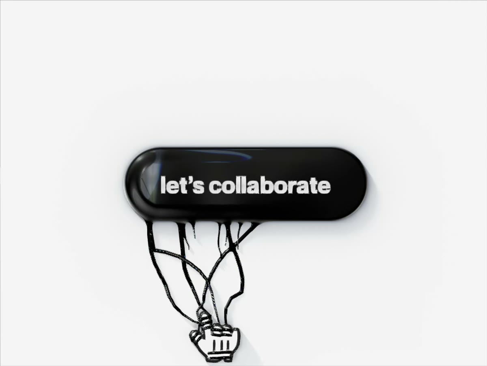

<sub>**05 · THE PROMPTING PLAYBOOK**</sub>

# How to talk to Claude Code like a designer

*Everything in this project was made by describing feelings, materials and references in plain English. These are the patterns that worked, with real examples from the build.*

---

## Before you start

Two questions to answer before the first message:

| | |
|:--:|:--|
| 🤔 | **Do I see the end result in my mind?** If you can't describe how it moves and what it's made of, Claude can't either. |
| 🤔 | **Do I know what Claude is capable of?** If not, ask it to research. It can search the web, read GitHub, find skills, and come back with techniques you didn't know existed. |

---

## The ten patterns

### 1 · Describe material, not implementation
> "It should move like melted rubber or mozzarella cheese… not like water."

You never need to say "increase damping" or "lower the smooth-min radius". Name the material and Claude translates it into physics.

### 2 · Use references everyone knows
> "Venom… a mix of a lizard and a spider."

A famous character or a familiar creature carries a whole motion vocabulary in two words.

### 3 · Show, don't only tell
> *Shared a material study image: approach, stretch, merge, self-heal.*

One reference image moved the result further than three rounds of text. Screenshots of what's wrong work too.

### 4 · Say what's wrong, precisely
> "When the cursor is on the left and right portion, there are a lot of increments in the primary size of the button, which shouldn't happen."

Pointing at *where* and *when* something looks wrong lets Claude find the cause (here: surface effects were pushing the outline outward) instead of guessing.

### 5 · Say what you like, so it's kept
> "I like the way that you did the glass effect. Keep that."

Iteration can quietly undo good things. Naming what to protect prevents that.

### 6 · Use relative adjustments
> "Nudge it up a little bit, you went too down."

"A little", "slightly", "significantly" are enough. Claude picks a sensible step and you correct from there.

### 7 · One idea per sentence, many sentences per message
The best rounds bundled 4–6 small, clear notes. Claude handles a list well; it struggles with one vague paragraph.

### 8 · Ask "why"
> "Why is the cursor not staying at the bigger size?"

Asking why surfaces the underlying decision, so you can change the rule rather than patch one symptom.

### 9 · Let Claude verify
Claude checked its own work in a browser every round: frame-by-frame captures, measurements ("the outline moved 0.5 px"), console errors. Ask for proof when it matters: "show me before and after".

### 10 · Ship with it, too
> "Can you help me open source this?"

Licensing, fonts, README, demo GIF, GitHub, a live link and these docs were all done in the same conversation.

---

## Words that mapped to code

A cheat sheet of phrases used in this project and what they turned into.

| You say | Claude changes |
|:--|:--|
| "too liquidy", "like water" | Smaller blend radius, heavier damping |
| "stretchy", "mozzarella", "cheesy" | Thinner strands, fibres that peel off, webs between strands |
| "jiggling", "too much viscosity" | Critically damped springs, rubber-band recoil |
| "magnetism" | A force pulling the strand body toward the cursor |
| "jet black" | Near-zero base colour, fewer bright reflections |
| "matte", "rubbery" | Broad soft highlight instead of mirror reflections |
| "glassy", "sleek" | Tighter bevel, crisp highlights |
| "realistic shadow" | Contact crease plus smooth exponential falloff |
| "elevated", "lifts" | Raise geometry, push the shadow out and soften it |
| "like a stock photo" | Blur, lower contrast, fade the edges |
| "hug the word" | Size the button from the measured text width |

---

## A template you can copy

```
I want to create [thing] that feels like [reference].
It's made of [material], and it moves like [motion analogy].
When [user action], it should [behaviour], and the [surface/element] should [secondary effect].
The environment is [lighting / background / mood].
Make a first attempt; we'll refine the movement together.
Research [where] for techniques and skills that will help do this accurately.
```

---



**Back to:** [Contents](README.md) · [Live demo](https://exteestudio.github.io/venom-button/)
